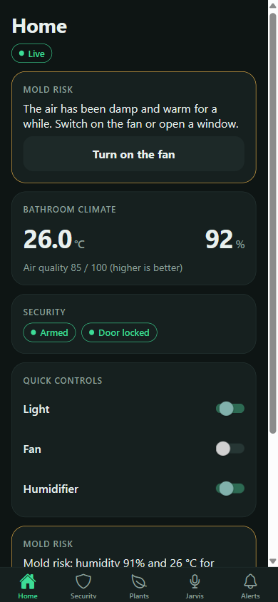
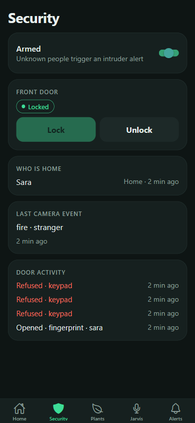
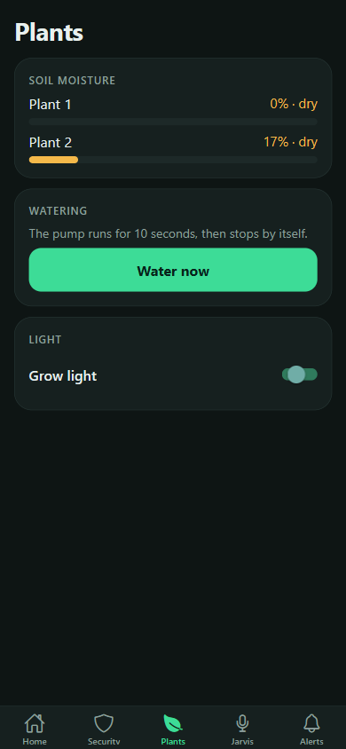
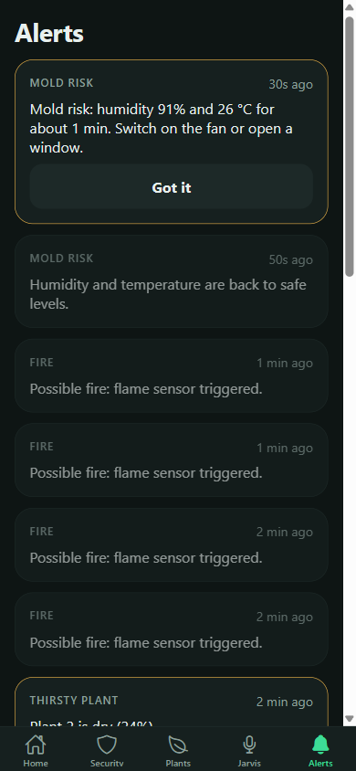

# Smart Home Security System

**Version: Beta 1.0** (see [CHANGELOG](CHANGELOG.md))

An AI and IoT smart home security system, built on a small model house.

A camera and AI watch for people, movement and fire. The door opens only for a known
fingerprint, face or password. The house also looks after plants, warns when a damp and
warm area reaches the conditions where mold grows, and has a voice assistant called Jarvis.

## What it does

| Feature | In simple words |
|---|---|
| Intruder detection | A camera watches the door and room. AI tells a person from a pet or an object. |
| Fire and smoke detection | The camera AI, a flame sensor and a gas sensor all watch for fire. |
| Smart door lock | Opens with a fingerprint, a face scan or a password. |
| Who is home | Face recognition shows who is here, who is away, and flags strangers. |
| Clap light switch | Clap, and the light turns on or off. |
| Jarvis voice assistant | Talk to the house. It answers questions and does things. |
| Plant care | Sensors check the soil. A pump waters and a light runs on a timer. |
| Mold-risk alert | A bathroom corner is made damp and warm. The system spots it and raises an alert. |
| App and alerts | One app shows the camera, sensors, history and alerts. |

## Folders

| Folder | What is in it |
|---|---|
| `docs/` | The proposal, the component list, the Jarvis feature list, the roadmap and the design notes |
| `firmware/` | Code that runs on the ESP32 boards (door, plant and camera nodes) |
| `backend/` | The server that collects data, stores it and sends alerts |
| `ai/` | Camera AI (`vision`), face recognition (`face`) and the voice assistant (`jarvis`) |
| `frontend/` | The phone app that controls the house and shows what is happening |
| `simulator/` | Pretends to be the boards, so software can be built before the parts arrive |
| `hardware/` | Wiring notes and pin maps |
| `molecular/` | The molecular biology experiment and write-up |
| `screenshots/` | Pictures of the app for each version |

## Where to start

Read `docs/ROADMAP.md` and `CONTRIBUTING.md`. Hardware and software are built separately
and joined at the end, using the message contract in `docs/CONTRACT.md`.

## Documents

- [Proposal](docs/proposal.pdf) (the first version; the scope has changed since, see the roadmap)
- [Component list](docs/component-list.pdf)
- [Jarvis features](docs/jarvis-features.pdf)

## Team

- Computer engineering (2): the boards, sensors, camera and model house
- Software engineering (2): server, app, camera AI, Jarvis
- Molecular biology (1): the final mold experiment

## Screenshots (Beta 1.0)

| Home | Security | Plants | Alerts |
|---|---|---|---|
|  |  |  |  |

More in `screenshots/v1.0/`.

## Versions

Beta 1.0, 1.1, 1.2 and so on for normal updates. A major update goes to 2.0, then 3.0. See `CONTRIBUTING.md`.
